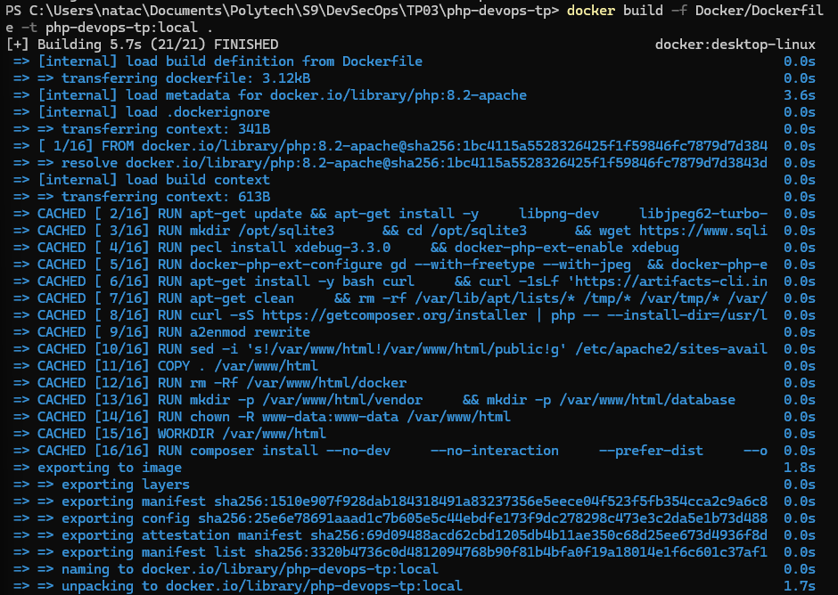
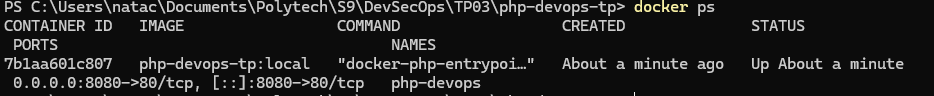
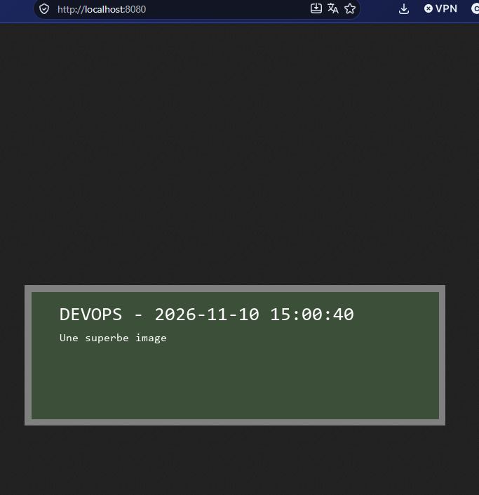
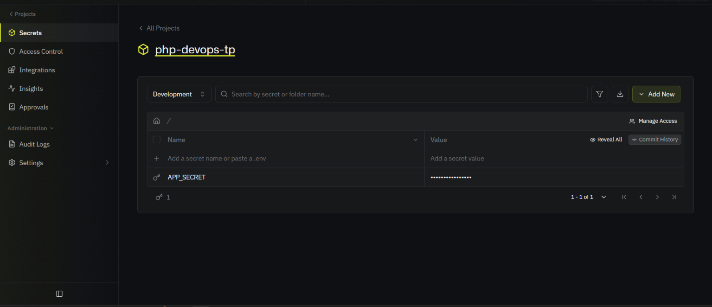
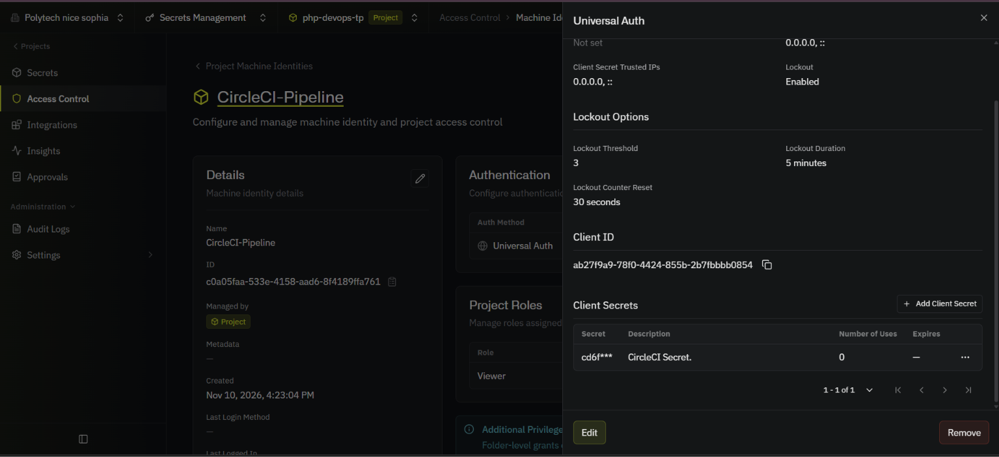
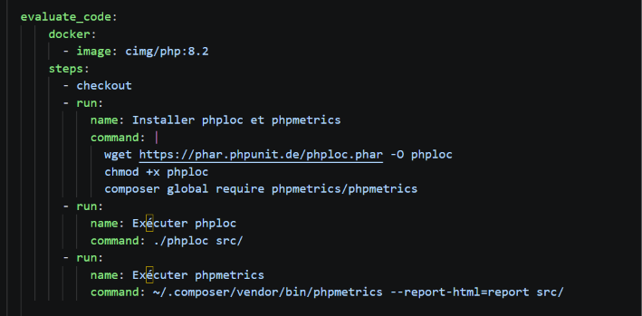
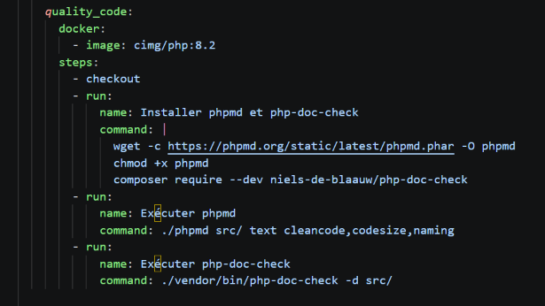
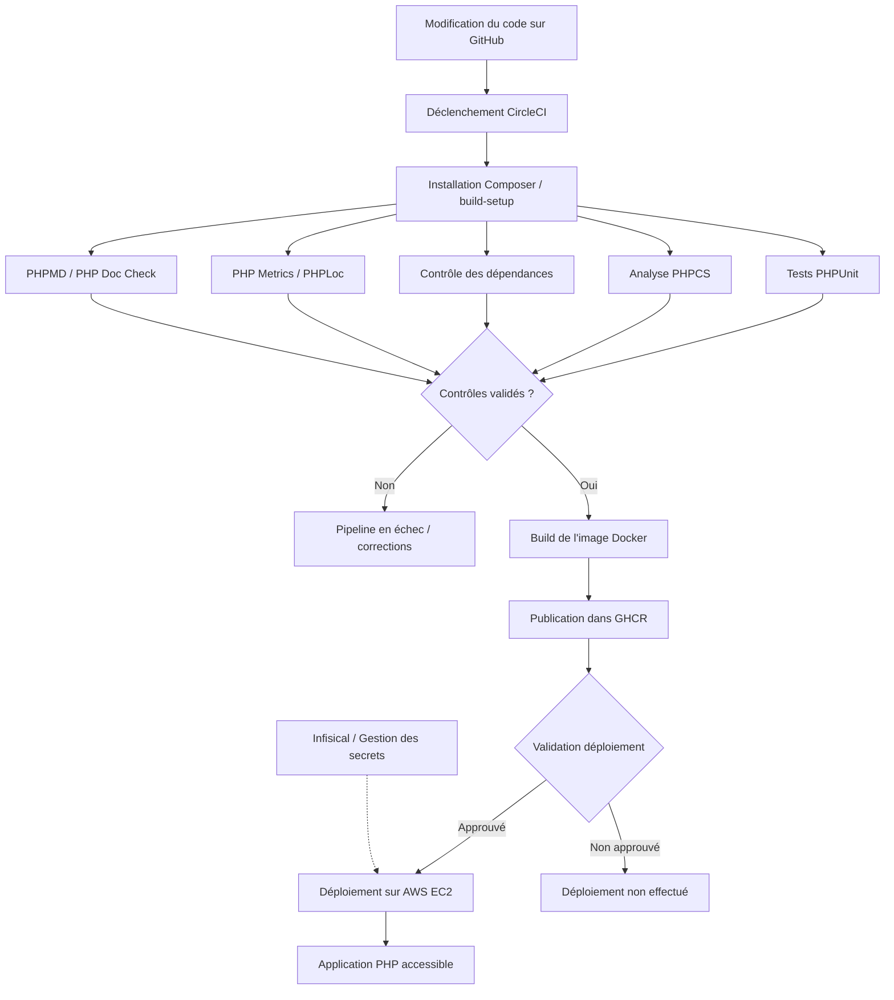

# TP03 — Configuration et sécurisation d'un pipeline CI/CD pour une application PHP

**SI5 — DevSecOps**  
**Enseignant :** Christian Delettre  
**Date :** 10 novembre 2026  
**Membres du groupe :** **Ismaïl Guerraoui · Adam Karbal · Nicolas Malay · Clément Menou**

---

## 1. Introduction

L'objectif de ce TP est de mettre en place un pipeline d'intégration et de déploiement continus (CI/CD) pour une application web PHP, puis de l'étendre et d'en améliorer la sécurité.

Le principe est d'automatiser les tâches répétitives : installation des dépendances, vérification de la qualité du code, exécution des tests, analyse des dépendances, construction d'une image Docker et déploiement sur un serveur. On cherche ainsi à rendre le processus plus reproductible et à détecter les problèmes le plus tôt possible.

On présente d'abord l'application et son exécution en local, puis la mise en place du pipeline, les extensions ajoutées, le déploiement et enfin les améliorations de sécurité.

---

## 2. Partie 1 — Compréhension du projet et configuration Docker

### 2.1. Analyse du projet PHP

Le projet fourni est une petite application PHP dont le rôle est de générer une image PNG.

| Fichier/dossier | Utilité |
|---|---|
| `public/index.php` | Point d'entrée HTTP : charge les dépendances, configure le rendu et appelle la génération de l'image |
| `src/ImageCreator.php` | Classe qui génère l'image à l'aide de l'extension PHP GD |
| `public/font/` | Police utilisée pour dessiner le texte sur l'image |
| `composer.json` et `composer.lock` | Dépendances PHP et versions verrouillées |
| `tests/Unit/` et `tests/Feature/` | Tests fournis avec PHPUnit |
| `Docker/Dockerfile` | Instructions de construction de l'image Docker |
| `.circleci/config.yml` | Définition des executors, jobs et workflows CircleCI |
| `.env.example` | Exemple de variable de configuration applicative |

### 2.2. Préparation de l'environnement Docker

Pour construire l'image localement, on utilise :

```powershell
docker build -f Docker/Dockerfile -t php-devops-tp:local .
```

On démarre ensuite un conteneur qui redirige le port `8080` de la machine vers le port `80` du conteneur :

```powershell
docker run -d --name php-devops -p 8080:80 php-devops-tp:local
```

La commande suivante permet de vérifier l'état du conteneur :

```powershell
docker ps -a
```

Après le lancement, l'application est accessible localement à l'adresse `http://localhost:8080`.



*Figure 1 — Construction de l'image Docker à partir du Dockerfile du projet.*



*Figure  2 — État du conteneur dans Docker.*



*Figure 3 — Affichage de l'application PHP depuis le navigateur local.*

---

## 3. Partie 2 — Mise en place du pipeline CI/CD

### 3.1. Configuration de CircleCI

CircleCI est relié au repository GitHub. Les opérations du pipeline sont décrites dans `.circleci/config.yml`, selon la syntaxe CircleCI 2.1.

Ce fichier contient trois éléments importants :

- **Executors** : environnements dans lesquels les jobs s'exécutent, par exemple un conteneur PHP pour les tests ou un environnement Docker pour le build.
- **Jobs** : tâches à réaliser, comme l'installation des dépendances, le lancement des tests ou la construction de l'image.
- **Workflows** : organisation des jobs, conditions d'exécution et dépendances entre étapes.

Dans le fichier d'origine, les images CircleCI utilisées pour les jobs PHP étaient en version **8.1**, alors que le projet requiert **PHP 8.2 minimum**. Il fallait donc harmoniser les versions afin d'éviter une erreur de compatibilité lors de l'installation Composer.

Le projet initial contenait également une différence de casse entre le chemin réel `Docker/Dockerfile` et le chemin `docker/Dockerfile` employé dans la commande de build CircleCI. La correction de ce point est nécessaire au fonctionnement du build.


*Figure 4 — Jobs et dépendances du pipeline CircleCI.*

### 3.2. Compréhension des jobs du pipeline initial

Le pipeline fourni contient déjà plusieurs jobs. On a commencé par comprendre leur fonctionnement et corriger leur configuration avant d'ajouter de nouvelles étapes.

| Job initial | Rôle |
|---|---|
| `build-setup` | Récupère le code, installe les dépendances Composer, utilise le cache et partage le workspace |
| `lint-phpcs` | Contrôle les règles de style et de compatibilité du code PHP |
| `security-check-dependencies` | Analyse les dépendances PHP avec un outil de vérification de vulnérabilités |
| `test-phpunit` | Exécute la suite de tests PHPUnit |
| `build-docker-image` | Construit l'image Docker et l'envoie vers GHCR |
| `deploy-ssh-staging` | Contient une procédure de déploiement SSH en préproduction dans le projet initial |
| `debug-info` | Affiche des informations sur l'environnement du job, à limiter pour éviter une fuite de variables |

Les jobs `lint-phpcs`, `security-check-dependencies` et `test-phpunit` dépendent de `build-setup` dans le workflow fourni. L'utilisation d'un workspace partagé permet de réutiliser les fichiers installés au lieu de repartir de zéro pour chaque job.

Le pipeline initial séparait le workflow de construction Docker (`container_workflow`) du workflow principal (`main_workflow`). Ce fonctionnement est important à comprendre : si le build et la publication sont indépendants des tests, une image peut être produite même lorsqu'un contrôle de qualité échoue. Pour un pipeline plus sûr, il est préférable de placer la publication et le déploiement après les vérifications bloquantes.

**Résultat à indiquer d'après CircleCI :** **[Nombre de jobs réussis / jobs en échec éventuels / référence d'un pipeline final].**


*Figure 5 — Résultats des jobs d'installation, de tests, de lint et d'analyse des dépendances.*

### 3.3. Construction automatique et publication dans GHCR

GHCR permet de stocker les images produites par le pipeline et de les récupérer ensuite depuis le serveur de déploiement.

Le job `build-docker-image` du projet prépare un nom d'image fondé sur le propriétaire et le nom du repository, puis calcule un tag à partir du nom de la branche. Il effectue ensuite trois opérations principales :

1. Authentification auprès de `ghcr.io`.
2. Construction de l'image Docker à partir du Dockerfile.
3. Publication de l'image dans GHCR avec `docker push`.

L'authentification repose sur des variables d'environnement définies dans CircleCI :

| Variable | Rôle |
|---|---|
| `GHCR_USERNAME` | Compte GitHub autorisé à publier le package |
| `GHCR_PAT` | Token d'accès GitHub permettant l'authentification au registre |

Ces valeurs ne doivent pas être placées directement dans le repository. Le token doit disposer des droits nécessaires pour publier le package et doit être révoqué ou renouvelé en cas d'exposition.

Le projet est destiné à produire des images sous une forme de ce type :

```text
ghcr.io/<proprietaire>/<depot>:<branche>
```

**Image finale publiée :** `[Coller ici la référence exacte visible dans GHCR]`.


*Figure 6 — Package Docker publié dans le registre GitHub.*

### 3.4. Gestion des secrets avec Infisical

Pour éviter de stocker les informations sensibles directement dans le code source, on a utilisé Infisical. On a créé un projet `php-devops-tp` avec une variable `APP_SECRET` dans l'environnement `Development`, dont la valeur est masquée dans l'interface.



*Figure 9 — Configuration du secret `APP_SECRET` dans Infisical.*

On a également créé une identité machine `CircleCI-Pipeline` utilisant l'authentification `Universal Auth` (Client ID et Client Secret), afin de permettre au pipeline de s'authentifier sans utiliser de compte personnel. Cette identité dispose du rôle `Viewer`, ce qui limite ses permissions.



*Figure 10 — Identité machine et configuration de l'authentification Universal Auth.*

Cette configuration permet de séparer les secrets du code source. Il faut toutefois veiller à ne jamais afficher leur valeur dans les logs ou dans l'application, notamment dans `ImageCreator.php`, qui pouvait initialement exposer `APP_SECRET` dans l'image générée.


---

## 4. Partie 3 — Extension du pipeline

### 4.1. Ajout d'outils d'évaluation du code

Pour compléter les tests existants, on a ajouté un job `evaluate_code` dans CircleCI afin d'analyser différentes métriques du code PHP.

Ce job utilise deux outils :
- **PHPLoc** : permet d'obtenir des statistiques sur le code (nombre de lignes, classes, méthodes, etc.).
- **PHP Metrics** : analyse notamment la complexité et la maintenabilité du code et génère un rapport HTML.

Les deux outils sont installés puis exécutés sur le dossier `src/` directement depuis le pipeline.



*Figure 10 — Configuration du job `evaluate_code` dans CircleCI.*

### 4.2. Intégration des contrôles de qualité du code

On a également ajouté un job `quality_code` afin d'automatiser certaines vérifications de qualité.

Il utilise deux outils :
- **PHPMD** : analyse le code selon les règles `cleancode`, `codesize` et `naming` afin de détecter des problèmes potentiels de qualité.
- **PHP Doc Check** : vérifie la documentation du code PHP pour identifier les éléments insuffisamment documentés.

Ces vérifications sont réalisées sur le dossier `src/` et permettent de compléter les tests unitaires par une analyse statique du code.



*Figure 11 — Configuration du job `quality_code` dans CircleCI.*

### 4.3. Organisation des jobs dans le workflow

Les quatre outils sont regroupés dans deux jobs CircleCI : evaluate_code pour les métriques et quality_code pour les contrôles de qualité. Cette organisation permet de centraliser les analyses et de les intégrer au pipeline CI/CD. On peut les exécuter après l'installation des dépendances, parallèlement aux tests, afin de limiter la durée du pipeline.

Le schéma ci-dessous récapitule l'architecture générale visée pour l'ensemble du TP. Il représente le **fonctionnement logique du pipeline** ; il faut vérifier que l'ordre et les dépendances correspondent bien au fichier `.circleci/config.yml` final.



*Figure 14 — Schéma logique du pipeline CI/CD, des vérifications jusqu'au déploiement. À ajuster si votre workflow réel est différent.*

### 4.4. Mise en place du serveur AWS EC2

Pour la dernière étape du pipeline, on utilise une instance **AWS EC2** qui héberge l'application. EC2 fournit une machine virtuelle accessible à distance, sur laquelle on peut installer Docker et exécuter l'image construite par CircleCI.

Les opérations nécessaires comprennent :

1. Création d'une instance EC2 et choix de son système d'exploitation.
2. Configuration de ses règles réseau (*Security Group*).
3. Mise en place de l'accès d'administration SSH.
4. Installation et démarrage de Docker.
5. Authentification éventuelle à GHCR pour récupérer une image privée.
6. Récupération et exécution de l'image correspondant à la version à déployer.
7. Vérification de l'accès à l'application depuis le navigateur.

**Instance utilisée :** `[Nom ou type d'instance, sans identifiant sensible]`  
**Système d'exploitation :** `[Distribution et version]`  
**Port public utilisé pour l'application :** `[80 ou 443, selon la configuration]`


*Figure 15 — État de l'instance EC2 utilisée pour le déploiement.*

### 4.5. Automatisation du déploiement de production

Dans le projet initial, le workflow faisait référence à un job **`deploy-ssh-production`**, mais sa définition était absente. Le sujet demandait donc de l'ajouter.

Le principe du déploiement est le suivant : une fois le pipeline validé et l'image publiée dans GHCR, CircleCI déclenche le job de production. Ce job s'authentifie auprès de la machine EC2, récupère l'image à déployer, remplace ou met à jour le conteneur applicatif puis vérifie que le service est disponible.

La séparation entre les étapes de contrôle et le déploiement évite de mettre en production une modification qui n'a pas passé les vérifications prévues. Une approbation manuelle peut également être conservée avant la mise en production, comme le suggère le mécanisme `hold` présent dans le workflow d'origine.

Les éléments sensibles nécessaires au déploiement, notamment les identifiants et clés SSH, ne doivent jamais être ajoutés dans le repository. La clé publique du serveur doit aussi être vérifiée afin de ne pas désactiver inutilement la vérification de son identité pendant la connexion SSH.

**Méthode de déploiement réellement utilisée :** `[SSH + docker pull/run, Docker Compose, autre]`  
**Déclenchement :** `[Automatique après validation, approbation manuelle, branche main, etc.]`  
**Contrôle final :** `[URL ou vérification HTTP utilisée, si partageable]`


*Figure 16 — Exécution du job de déploiement vers l'instance EC2.*


*Figure 17 — Application PHP accessible après le déploiement sur EC2.*

**Bilan de la partie 3.** L'ajout des outils d'analyse rend le pipeline plus complet : les tests ne sont plus le seul moyen de détecter des problèmes. L'étape de déploiement relie ensuite la construction de l'image à l'exécution réelle de l'application sur un serveur.

---

## 5. Partie 4 — Documentation du processus

### 5.1. Procédure de reproduction

Le fonctionnement général du projet peut être reproduit en suivant les étapes suivantes :

1. **Récupérer le repository GitHub** et examiner les fichiers `composer.json`, `Docker/Dockerfile` et `.circleci/config.yml`.
2. **Préparer Docker localement**, construire l'image et tester l'application sur `localhost:8080`.
3. **Connecter le projet à CircleCI** afin que les modifications du repository puissent déclencher le pipeline.
4. **Configurer les variables protégées** nécessaires à GHCR, à Infisical et au déploiement, sans exposer leurs valeurs dans le code ni les logs.
5. **Exécuter les jobs de CI** et corriger les erreurs de dépendances, de configuration ou de qualité du code.
6. **Contrôler l'image produite dans GHCR** et son tag.
7. **Préparer le serveur EC2** et vérifier qu'il peut récupérer et exécuter l'image.
8. **Exécuter le job de déploiement** selon les conditions prévues par le workflow.
9. **Vérifier le service déployé**, puis consulter les journaux du pipeline et du conteneur si nécessaire.

### 5.2. Principaux fichiers de configuration

| Fichier | Rôle | Point à vérifier |
|---|---|---|
| `.circleci/config.yml` | Jobs, executors, workflows et dépendances | Chaque job est déclaré et référencé correctement |
| `Docker/Dockerfile` | Création de l'image applicative | PHP compatible et dépendances installées |
| `composer.json` | Déclaration des dépendances | Dépendances de production et de développement cohérentes |
| `composer.lock` | Versions résolues et verrouillées | Versionné avec les modifications de Composer |
| `.dockerignore` | Exclusion de fichiers du contexte de build | Pas de secrets ou de fichiers inutiles copiés |
| `.env.example` | Documentation des variables attendues | Aucune vraie valeur secrète |

### 5.3. Vérifications et diagnostic

| Vérification | Exemple de commande ou d'action |
|---|---|
| Vérifier les conteneurs locaux | `docker ps -a` |
| Lire les logs d'un conteneur | `docker logs php-devops` |
| Voir les images construites | `docker images` |
| Voir les modifications locales | `git status` et `git diff` |
| Tester les tests unitaires | `./vendor/bin/phpunit --testsuite=Unit` |
| Vérifier un job CI | Consulter son statut et ses logs dans CircleCI |
| Vérifier la publication Docker | Consulter les packages GHCR et le tag attendu |
| Vérifier le déploiement | Accès HTTP(S) à l'application et logs du conteneur EC2 |

**Remarque :** les commandes exactes de contrôle sur EC2 dépendent de la méthode de déploiement effectivement retenue par le groupe.

---

## 6. Partie 5 — Sécurité à tous les étages

La dernière partie du TP consiste à vérifier que l'automatisation mise en place n'introduit pas de nouvelles faiblesses. Une chaîne CI/CD traite du code source, des identifiants, des images et des machines de déploiement : sa sécurité ne se limite donc pas au code PHP.

### 6.1. Sécurité du repository et des comptes GitHub

On distingue la sécurité des comptes et celle du repository :

- **Authentification renforcée** : activer l'authentification multifacteur pour les comptes ayant accès au projet.
- **Gestion des collaborateurs** : donner uniquement les permissions nécessaires à chaque membre du groupe.
- **Protection de la branche principale** : demander des validations avant la fusion de modifications importantes, si les fonctionnalités du dépôt le permettent.
- **Analyse du dépôt** : vérifier qu'aucun fichier `.env`, token, clé privée ou mot de passe n'a été commité.
- **Permissions des tokens** : utiliser des tokens à durée de vie limitée et des droits minimaux.

L'erreur HTTP 403 rencontrée lors du `git push` illustre que GitHub applique un contrôle des autorisations : la connaissance de l'URL d'un dépôt ne suffit pas pour y écrire.

**Vérifications réellement effectuées :** `[MFA / protection de branche / permissions collaborateurs / secret scanning — ne garder que ce qui a été vérifié]`.


*Figure 18 — Vérification de la configuration du repository et des accès.*

### 6.2. Fiabilité et sécurité de l'image Docker

Une image Docker qui se construit correctement n'est pas automatiquement sécurisée. Elle peut contenir des dépendances vulnérables, des composants inutiles ou des fichiers qui ne devraient pas être publiés.

Plusieurs contrôles sont pertinents :

- **Scanner l'image** avec un outil comme Trivy afin d'identifier les vulnérabilités connues.
- **Analyser les dépendances PHP** avec le job dédié du pipeline.
- **Limiter les composants installés** et séparer, lorsque c'est possible, les outils de développement de l'image utilisée en production.
- **Éviter d'incorporer des secrets** pendant le build ou dans des couches Docker.
- **Vérifier le contexte de build** à l'aide de `.dockerignore`.
- **Mettre à jour les images de base** et privilégier une version identifiée, idéalement reproductible.

Dans le Dockerfile initial, plusieurs éléments méritent une attention particulière : la présence d'Xdebug, utile pour le développement mais généralement superflue en production ; l'installation de différents outils système ; et l'absence de garantie qu'une image de base utilisant un tag évolutif restera identique dans le temps.

Le projet initial expose également `public/info.php`, qui appelle `phpinfo()`. Une telle page révèle des informations techniques sur la configuration PHP et doit être retirée ou rendue inaccessible sur un serveur public.

Un scan peut être lancé avec :

```bash
trivy image <nom-complet-de-l-image>:<tag>
```

**Outil effectivement utilisé :** `[Trivy ou autre]`  
**Résultat du scan :** `[Nombre de vulnérabilités par niveau de sévérité, uniquement si réellement relevé]`  
**Corrections appliquées :** `[Correctifs effectivement réalisés]`


*Figure 19 — Analyse de sécurité de l'image Docker, avec résultats visibles.*

### 6.3. Sécurité de l'instance AWS EC2

La machine de déploiement doit être protégée indépendamment du pipeline. Les principaux points de contrôle sont :

| Élément | Mesure attendue |
|---|---|
| **SSH (port 22)** | Accès limité aux adresses ou aux sources de déploiement autorisées |
| **HTTP / HTTPS** | Exposer uniquement les ports nécessaires à l'application |
| **Comptes et clés** | Authentification par clé, permissions minimales et protection des clés privées |
| **Mises à jour** | Système et Docker maintenus à jour |
| **Secrets** | Valeurs fournies à l'exécution, sans stockage en clair dans le code ou l'image |
| **Journaux** | Possibilité de consulter les logs Docker et les événements utiles au diagnostic |
| **Disponibilité** | Redémarrage du conteneur et contrôle de la santé de l'application |

Le **Security Group** d'EC2 agit comme un filtrage réseau. Il doit autoriser l'accès à l'application tout en limitant les ports d'administration. Le port 22 ne devrait pas être laissé ouvert à toutes les adresses IP sans justification.

**Configuration réellement appliquée :** `[Règles entrantes, méthode d'accès SSH et mesures de durcissement à résumer]`.


*Figure 20 — Règles réseau associées à l'instance EC2.*

### 6.4. Protection des secrets et du pipeline lui-même

CircleCI et Infisical sont des éléments sensibles : un job compromis pourrait chercher à lire les variables ou à modifier l'image publiée.

Il est donc important de :

1. Masquer les secrets dans les logs et ne jamais utiliser une commande de diagnostic qui affiche toutes les variables sensibles.
2. Employer une identité machine Infisical pour les traitements automatisés, avec un accès limité aux secrets indispensables.
3. Protéger les credentials de publication GHCR et les accès SSH de production.
4. Restreindre le déclenchement des jobs de déploiement aux branches ou environnements autorisés.
5. Ajouter, lorsque cela correspond à l'organisation du projet, une validation avant le déploiement de production.

Dans le fichier CircleCI initial, le job `debug-info` affichait notamment le résultat de `env`. Cette commande peut exposer des variables d'environnement. Elle est donc à supprimer ou à limiter fortement avant d'utiliser des secrets réels.

Enfin, il faut distinguer deux niveaux de validation : un **pipeline vert** prouve que les commandes prévues se sont terminées comme attendu, mais il ne prouve pas que l'application ou l'infrastructure est exempte de vulnérabilités.

**Bilan de la partie 5.** La sécurité concerne l'ensemble de la chaîne : authentification aux services, permissions GitHub, dépendances, image Docker, circulation des secrets, réseau AWS et conditions de déploiement. Les captures permettent de justifier les mesures effectivement vérifiées, plutôt que de simplement les énumérer.

---

## 7. Difficultés rencontrées et solutions apportées

Voici les difficultés identifiées pendant la préparation et les manipulations, ainsi que leur cause et leur résolution ou correction à appliquer.

| Difficulté | Cause identifiée | Solution / correction |
|---|---|---|
| Conflit sur le nom `php-devops` | Un conteneur Docker portait déjà ce nom | Vérifier `docker ps -a`, réutiliser ou supprimer l'ancien conteneur avant de relancer |
| Erreur GitHub **403** lors d'un `git push` | Le compte utilisé ne disposait pas des droits d'écriture sur le dépôt partagé | Ajouter le compte comme collaborateur ou passer par un flux de contribution autorisé |
| Versions PHP incompatibles | Composer exige PHP 8.2 alors que les executors initiaux utilisaient PHP 8.1 | Harmoniser les images d'exécution CircleCI avec la version du projet |
| Chemin du Dockerfile incorrect | Différence `docker/` / `Docker/` sous Linux | Utiliser la casse exacte du répertoire dans la commande `docker build` |
| Job de production absent | `deploy-ssh-production` était référencé mais non défini | Définir le job et ses dépendances dans le workflow |
| Secrets difficiles à gérer manuellement | Plusieurs outils ont besoin d'identifiants distincts | Centraliser les secrets et employer des variables protégées / identités dédiées |

Les deux premiers problèmes ont été observés dans les manipulations du groupe. Les autres points ont été identifiés dans le projet initial et ont guidé la vérification de la configuration.

**Autres difficultés réellement rencontrées pendant la suite du TD :** `[Ajouter ici, si nécessaire, les erreurs CircleCI / AWS / Composer rencontrées et les corrections exactes]`.

---

## 8. Synthèse des résultats

Le tableau suivant permet de rassembler les preuves des différentes parties en s'appuyant sur la dernière version du projet et les captures du groupe.

| Étape | Résultat à documenter | Preuve prévue |
|---|---|---|
| Exécution locale | Image construite, conteneur lancé, application accessible | Figures 2 à 4 |
| GitHub | Repository partagé et modifications versionnées | Figure 5 |
| CircleCI | Exécution des jobs CI | Figures 6 et 7 |
| GHCR | Publication d'une image taguée | Figure 8 |
| Infisical | Secret disponible sans exposition de sa valeur | Figure 9 |
| Analyse de code | Quatre nouveaux jobs et résultats associés | Figures 10 à 13 |
| AWS EC2 | Déploiement et accès à l'application | Figures 15 à 17 |
| Sécurité | Vérifications GitHub, image Docker et réseau EC2 | Figures 18 à 20 |

**État final du pipeline :** `[Indiquer ici un résumé factuel, par exemple le nombre de jobs passés, les étapes bloquantes encore présentes et le résultat du déploiement.]`

---

## 9. Conclusion

Ce TP nous a permis de travailler sur l'ensemble d'une chaîne CI/CD, depuis le code source d'une application PHP jusqu'à sa conteneurisation et son déploiement. Il a aussi montré l'importance de comprendre un pipeline existant avant de le modifier : des détails apparemment simples, comme une version de PHP ou la casse d'un chemin, peuvent empêcher plusieurs jobs de fonctionner.

L'ajout des outils de métriques et d'analyse statique complète les tests et permet d'obtenir davantage d'informations sur le code. La publication d'images dans GHCR et le déploiement sur EC2 illustrent ensuite la manière dont l'intégration continue peut être reliée à la mise à disposition d'une application.

Enfin, la partie sécurité montre qu'un pipeline fonctionnel n'est pas nécessairement un pipeline sécurisé. Il faut notamment contrôler les permissions, protéger les secrets, examiner les images Docker et limiter les accès à l'infrastructure. Ces vérifications font partie intégrante d'une démarche DevSecOps.

---
